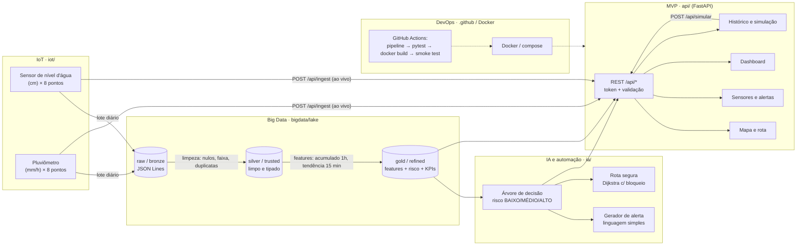

# Arquitetura geral

## Como as áreas se conectam

1. **IoT → Big Data:** os sensores mock geram leituras no formato do dispositivo (`sensor_id`, `tipo`, `valor`, `unidade`, `ts`). Elas caem na camada **raw** sem tratamento, inclusive com falhas reais de campo: nulos, negativos, picos de 999 cm e duplicatas.
2. **Big Data → IA:** a **silver** limpa e une os dois sensores numa linha por ponto × instante. A **gold** calcula as features (chuva acumulada na última hora, tendência do nível em 15 min) e recebe a previsão da IA.
3. **IA → App:** o risco previsto alimenta o mapa, o bloqueio de vias, a rota segura e o texto do alerta.
4. **Big Data → Dashboard:** os KPIs são medidas calculadas sobre a gold, já com a saída da IA.
5. **IoT ao vivo → IA → App:** a leitura enviada por `POST /api/ingest` é validada, gravada na raw (`ao_vivo.jsonl`), classificada na hora e exibida na tela de sensores.
6. **DevOps:** cada push roda o pipeline inteiro, os testes, o build da imagem e um smoke test do container (que inclui conferir que a rota protegida devolve 401).

## Território simulado

8 pontos em 3 bairros fictícios (Vila Ribeirão, Jardim Várzea, Centro) e 12 vias. Cada ponto tem um fator de **suscetibilidade de drenagem**: a Ponte Velha e a Praça do Córrego alagam primeiro, o Terminal quase nunca. Ver `core/bairro.py`.
